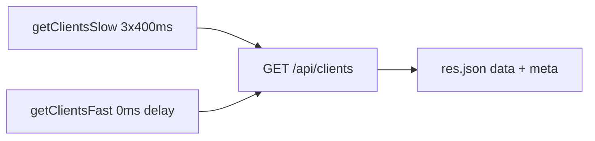

# Accelerar GET /api/clients (< 300 ms)

## Causa (ja diagnosticada)

[`src/app.js`](../src/app.js) crida `getClientsSlow()`, que fa **3 × `await delay(400)` en sèrie** (~1200 ms). El format de sortida ja és el correcte; el coll d’ampolla són només aquestes esperes artificials.

## Enfocament triat

Reutilitzar **`getClientsFast()`** (ja implementada a [`src/db.js`](../src/db.js)), que construeix el mateix shape de clients (id, name, company, owner, tags) **sense delays**. No cal parallelitzar els `delay(400)`: eliminar-los via la funció ràpida és el camí previst pel lab i garanteix < 300 ms en local.



## Passos ordenats

1. A [`src/app.js`](../src/app.js): canviar l’import de `getClientsSlow` per `getClientsFast`.
2. A la ruta `GET /api/clients`: substituir `await getClientsSlow()` per `await getClientsFast()`.
3. **No tocar** l’estructura de la resposta: seguir amb `res.json({ data, meta: { count, note } })`.
4. **No modificar** [`src/db.js`](../src/db.js) ni esborrar `getClientsSlow`.

Únic canvi de codi esperat (conceptual):

```js
// abans
const data = await getClientsSlow();
// després
const data = await getClientsFast();
```

## Fitxers

| Fitxer | Acció |
|--------|--------|
| [`src/app.js`](../src/app.js) | Únic fitxer a editar (import + crida) |
| [`src/db.js`](../src/db.js) | Sense canvis (ja exporta `getClientsFast`) |
| [`tests/app.test.js`](../tests/app.test.js) | Sense canvis |

## Riscos

- **Regressió de format:** si es canvia el shape dels objectes de `data`, el contracte `{ data, meta }` es trenca. Mitigació: usar `getClientsFast`, que ja retorna el mateix shape.
- **`npm test` no mesura latència:** els tests comproven que la llista torna, no que respongui en < 300 ms. La latència queda garantida per l’absència dels tres `delay(400)`.

## Com validar

### Terminal local (`npm test`)

1. Des de l’arrel del repo: `npm test`.
2. Comprovar que passa `clients amb token retorna llista` → 200 i `data.length > 0`.
3. Indici de rendiment: el suite hauria d’acabar clarament més ràpid que amb `getClientsSlow` (~1,2 s només a clients).
